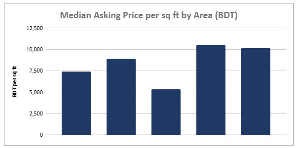
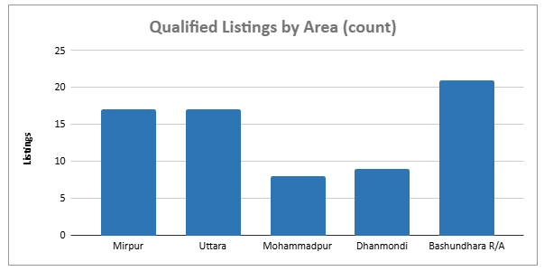
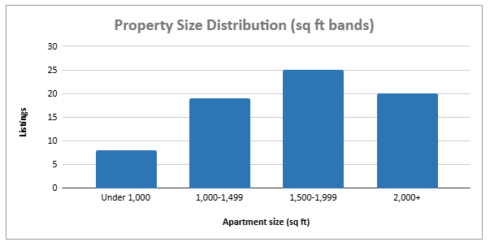
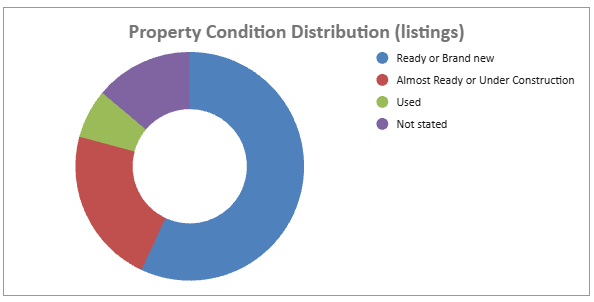
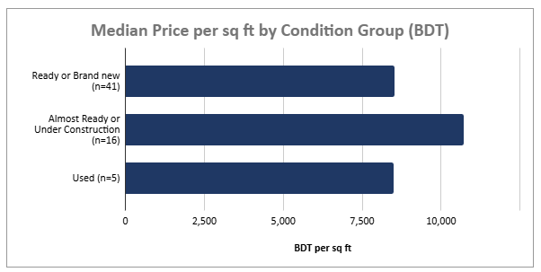
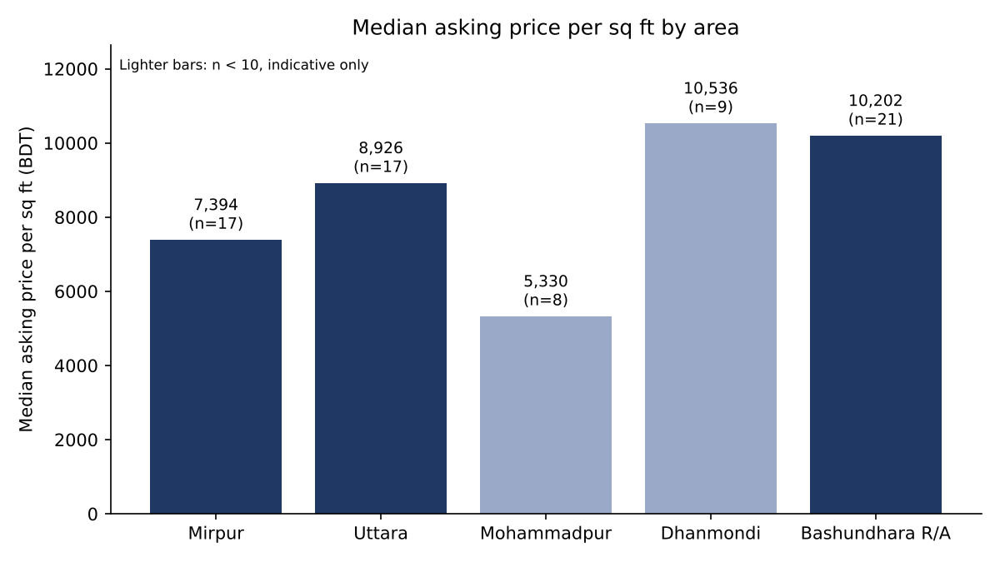

# Property Atlas: Dhaka Flat Market Snapshot 2026

Asking-price research on 72 apartments for sale in five Dhaka neighbourhoods, collected from two public property portals in November 2026. The main metric is asking price per square foot (BDT), compared by area, size, condition and bedroom count.

**Workbook:** [view on Google Sheets](https://docs.google.com/spreadsheets/d/1BGlHnQnST3Ha7iMleSVyZLtZErPBhLqn3sdq51hJ9QE/edit?usp=sharing) (view-only) · also included in [`data/`](data/)

| Listings | Areas | Portals | Median asking price | Range |
|:---:|:---:|:---:|:---:|:---:|
| 72 | 5 | 2 | 8,913 BDT / sq ft | 3,913 to 22,020 |

These are **asking** prices from listing pages. They are not sale prices.

## Contents

- [The question](#the-question)
- [Dashboard](#dashboard)
- [What the data shows](#what-the-data-shows)
- [How the data was built](#how-the-data-was-built)
- [Repository layout](#repository-layout)
- [Run the analysis](#run-the-analysis)
- [Limitations](#limitations)
- [Data source and reuse](#data-source-and-reuse)

## The question

How do residential asking prices differ across Mirpur, Uttara, Mohammadpur, Dhanmondi and Bashundhara R/A, and where could a property agent or listing platform add value through better listing coverage or clearer pricing?

The workbook is the main deliverable. This repository wraps it with flat CSV exports, a Python script that recomputes every figure in the analysis sheets, and notes on method and data quality.

## Dashboard

Screenshots of the five charts on the workbook's `05 Dashboard` sheet.

<table>
  <tr>
    <td></td>
    <td></td>
  </tr>
  <tr>
    <td></td>
    <td></td>
  </tr>
  <tr>
    <td colspan="2" align="center"></td>
  </tr>
</table>

The first chart has no area names on its x-axis in the workbook. The bars are in the order Mirpur, Uttara, Mohammadpur, Dhanmondi, Bashundhara R/A. See [known issue 4](docs/known-issues.md#4-dashboard-chart-1-has-no-category-labels). A labelled version drawn from the same data is below.

## What the data shows

Median asking price per sq ft, calculated as asking price ÷ size:

| Area | Listings | Median (BDT/sq ft) | |
|---|---:|---:|---|
| Mohammadpur | 8 | 5,330 | indicative only (n < 10) |
| Mirpur | 17 | 7,394 | |
| Uttara | 17 | 8,926 | |
| Bashundhara R/A | 21 | 10,202 | |
| Dhanmondi | 9 | 10,536 | indicative only (n < 10) |
| **All areas** | **72** | **8,913** | |



Other results:

- **Size:** price per sq ft rises with size, from 6,017 (1,000 to 1,499 sq ft) to 9,920 (1,500 to 1,999) and 11,078 (2,000+). The under-1,000 band (6,754, n = 8) sits slightly above the 1,000 to 1,499 band, so the trend is not strictly monotonic.
- **Size mix affects area medians.** 11 of Bashundhara R/A's 21 listings are 2,000+ sq ft; Mohammadpur has none. No size-adjusted comparison has been done.
- **Condition:** almost-ready or under-construction flats have the highest median (10,703, n = 16), against 8,521 for ready or brand new (n = 41) and 8,500 for used (n = 5).
- **Price transparency:** 57 of 72 listings show their own per-sq-ft rate. For 33 it matches asking price ÷ size within 2%; for 24 it does not. The remaining 15, all from Aabason, list a total price only.
- **Outlier:** one listing is flagged by Tukey fences (DPM-049, Dhanmondi, 22,020 BDT/sq ft). It stays in the dataset.

Distribution of every listing by area: [`docs/images/analysis/ppsf_distribution_by_area.png`](docs/images/analysis/ppsf_distribution_by_area.png).

## How the data was built

1. Listings came from bdHousing (search-result pages) and Aabason (listing pages), shown between March and 26 November 2026. 59 of the 72 are dated October or November.
2. Three research files were merged and de-duplicated into a pool of 139 listings. 79 had a numeric price and 72 qualified for pricing analysis.
3. Price per sq ft is calculated as asking price ÷ size. The portal's own rate, where shown, is kept and compared against it.
4. Outliers are flagged with Tukey fences and kept, not deleted.
5. Each record carries an evidence tier. 12 were checked on the individual listing page (Tier A); 60 rest on the search-results card (Tier B).

Full definitions are in [`docs/methodology.md`](docs/methodology.md).

## Repository layout

```
.
├── data/
│   ├── Dhaka_Flat_Market_Snapshot_2026.xlsx   original workbook, unmodified
│   ├── listings.csv                           sheet 02, 72 rows
│   └── source_register.csv                    sheet 06, 72 rows
├── scripts/
│   ├── export_data.py                         workbook -> CSV
│   └── analyze.py                             recompute, verify, check, chart
├── outputs/                                   tables written by analyze.py
├── docs/
│   ├── methodology.md
│   ├── data-dictionary.md
│   ├── known-issues.md
│   └── images/
│       ├── dashboard/                         screenshots from the workbook
│       └── analysis/                          charts drawn by analyze.py
├── requirements.txt
└── README.md
```

Workbook sheets:

| Sheet | Contents |
|---|---|
| 01 Project Overview | Question, scope, sources, limitations |
| 02 Master Database | One row per listing; price per sq ft, gap, size segment and outlier flag are formulas |
| 03 Pricing Analysis | Stats by area, condition, size, bedrooms and platform; Tukey fences; correlations |
| 04 Market Segmentation | Distribution tables and the price-transparency view of the full pool |
| 05 Dashboard | KPI row and five charts |
| 06 Source Register | Source URL, evidence type and date for every record |

Blue font in the workbook marks a hardcoded audit input; black is a formula.

## Run the analysis

Python with pandas, NumPy, openpyxl and matplotlib (run on Python 3.12). No API keys, environment variables or database are needed.

```bash
python -m venv .venv
source .venv/bin/activate        # Windows: .venv\Scripts\activate
pip install -r requirements.txt

python scripts/export_data.py    # optional: rebuild data/*.csv from the workbook
python scripts/analyze.py
```

`analyze.py`:

1. recomputes the summary tables from `data/listings.csv` and writes them to `outputs/`;
2. compares 121 recomputed figures with the values stored in the workbook (all 121 matched on the last run);
3. checks the listing data for inconsistencies and writes them to `outputs/data_checks.csv`;
4. redraws the charts in `docs/images/analysis/`.

It exits with an error if a workbook figure does not match. Use `--no-verify` or `--no-charts` to skip steps. One of the 121 figures matches only because the script reproduces a formula problem in the workbook; see [known issue 1](docs/known-issues.md#1-median-absolute-gap-in-03-pricing-analysis-is-understated).

## Limitations

- Asking prices, not sale prices.
- 72 records, below the 110 originally targeted. Mohammadpur (8) and Dhanmondi (9) are under the workbook's own threshold of 10.
- Two portals. 60 of 72 records come from results pages, and seller availability was not confirmed for any record.
- Listing counts reflect what the portals display, not buyer demand.
- The workbook has a few inconsistencies (collection dates, one formula, one chart). They are listed with fixes in [`docs/known-issues.md`](docs/known-issues.md).

## Data source and reuse

Listings were taken from publicly visible pages of bdHousing and Aabason. The dataset includes listing URLs but no photos or contact details. Check each portal's terms before reusing or redistributing the data. No license file is included because licensing terms for the data have not been established.
